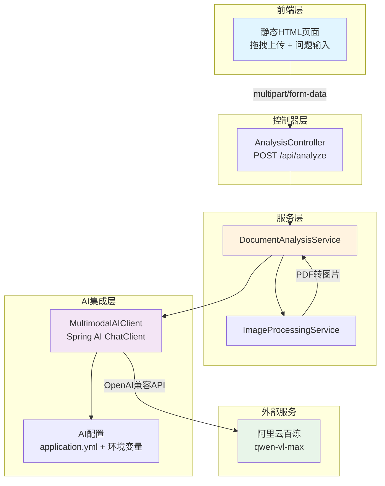

# 多模态文档分析 Agent

这是一个基于 Spring Boot 和 Spring AI 构建的智能文档分析系统，展现了现代 Java AI 应用开发的最佳实践。该项目作为技术作品集，展示了从零到一构建生产级 AI 应用的能力。

## 🎯 项目概述

本项目分四个阶段迭代开发：

- **Stage 1（当前阶段）**：基础多模态分析 - 图片/PDF 上传 + 视觉语言模型问答
- **Stage 2**：多模态 RAG - 集成 pgvector 向量数据库，实现文档检索增强生成
- **Stage 3**：Agent 工具调用 - 集成 OCR、表格提取、计算器、图表生成等工具
- **Stage 4**：评估与优化 - 准确率测试、性能优化、监控告警、容器化部署

## ✨ Stage 1 功能特性

- ✅ 支持多种图片格式（JPEG、PNG、GIF、WebP）
- ✅ 支持 PDF 文档分析（自动渲染为图片）
- ✅ 基于阿里云百炼 qwen-vl-max 视觉语言模型
- ✅ OpenAI 兼容接口，可一键切换至 GPT-4o
- ✅ 拖拽式上传的现代化前端界面
- ✅ **企业级 API 规范**：统一响应体、错误码体系、请求追踪
- ✅ **RESTful API 版本化**：`/api/v1/analyze`（当前），`/api/analyze`（已废弃但保留兼容）
- ✅ **请求链路追踪**：每个请求自动生成 traceId，支持日志关联
- ✅ **结构化日志**：JSON 格式日志（生产环境），可读格式（开发环境）
- ✅ 完整的错误处理和参数验证
- ✅ 单元测试和集成测试覆盖

## 🏗 系统架构



## 🔧 技术栈

| 类别 | 技术 | 版本 | 用途 |
|------|------|------|------|
| 核心框架 | Spring Boot | 3.2.0 | Web 应用框架 |
| 语言 | Java | 17+ | 开发语言 |
| AI 集成 | Spring AI | 1.0.0-M3 | AI 模型调用抽象层 |
| LLM 服务 | 阿里云百炼 | qwen-vl-max | 视觉语言模型 |
| PDF 处理 | Apache PDFBox | 3.0.1 | PDF 渲染 |
| 构建工具 | Maven | 3.9+ | 项目构建 |
| 测试框架 | JUnit 5 + Mockito | - | 单元/集成测试 |

## 🚀 快速开始

### 前置条件

- Java 17 或更高版本
- Maven 3.6 或更高版本
- 阿里云 DashScope API Key（[获取地址](https://dashscope.aliyun.com/)）

### 1. 克隆项目

```bash
git clone <repository-url>
cd image-text-analyzer
```

### 2. 配置 API Key

**方式一：环境变量（推荐）**

```bash
export DASHSCOPE_API_KEY="your-api-key-here"
```

**方式二：系统属性**

```bash
mvn spring-boot:run -DDASHSCOPE_API_KEY="your-api-key-here"
```

### 3. 启动应用

```bash
mvn spring-boot:run
```

应用将在 `http://localhost:8080` 启动。

### 4. 访问界面

在浏览器中打开：http://localhost:8080

## 📖 API 接口规范

### 接口概览

| 接口路径 | 方法 | 说明 | 状态 |
|---------|------|------|------|
| `/api/v1/analyze` | POST | 文档分析接口（当前版本） | ✅ 推荐使用 |
| `/api/analyze` | POST | 文档分析接口（旧版本） | ⚠️ 已废弃 |
| `/api/health` | GET | 健康检查接口 | ✅ 正常 |

### 统一响应体格式

所有 API 接口均返回统一的响应体结构：

```json
{
  "code": "00000",
  "message": "成功",
  "data": { ... },
  "traceId": "a1b2c3d4e5f6..."
}
```

**字段说明：**
- `code`：错误码，成功为 `"00000"`，错误格式为 `E + HTTP状态码 + 序号`
- `message`：响应消息，成功或错误描述
- `data`：业务数据，成功时返回，失败时为 `null`
- `traceId`：请求追踪 ID，用于日志关联和问题排查

### 请求追踪

每个请求都会自动生成一个 `traceId`，用于关联请求日志：

- **自动生成**：如果请求头中没有 `X-Request-Id`，系统会自动生成一个 UUID
- **透传机制**：如果请求头包含 `X-Request-Id`，系统会原样透传作为 traceId
- **响应头返回**：响应头 `X-Trace-Id` 会返回本次请求的 traceId
- **日志关联**：所有日志中都会包含 traceId，便于问题排查

### API 使用示例

#### 1. 分析图片（推荐使用 v1 接口）

```bash
curl -X POST http://localhost:8080/api/v1/analyze \
  -H "X-Request-Id: my-custom-trace-id-12345" \
  -F "file=@example.jpg" \
  -F "question=这张图片中的内容是什么？"
```

**成功响应示例：**

```json
{
  "code": "00000",
  "message": "成功",
  "data": {
    "answer": "这是一张包含技术架构图的图片，展示了...",
    "model": "qwen-vl-max",
    "latencyMs": 1523,
    "metadata": {
      "fileName": "example.jpg",
      "fileType": "image",
      "fileSize": 245632,
      "contentType": "image/jpeg"
    }
  },
  "traceId": "my-custom-trace-id-12345"
}
```

#### 2. 分析 PDF

```bash
curl -X POST http://localhost:8080/api/v1/analyze \
  -F "file=@document.pdf" \
  -F "question=请总结这个文档的主要内容"
```

#### 3. 使用旧版接口（已废弃）

```bash
curl -X POST http://localhost:8080/api/analyze \
  -F "file=@example.jpg" \
  -F "question=测试"
```

**响应头会包含废弃提示：**

```
Deprecation: true
Sunset: Thu, 31 Dec 2026 23:59:59 GMT
Link: </api/v1/analyze>; rel="successor-version"
```

### 错误码表

#### 错误码规则

**重要**：错误码一旦发布不得修改含义、不得复用。本表即接口契约。

- 错误码格式：`E + HTTP状态码 + 两位序号`（如 `E40001`）
- 成功码：`00000`
- 新增错误码应按分区顺序添加，预留码位由后续 PR 填充

#### 成功响应

| 错误码 | HTTP 状态 | 说明 |
|--------|----------|------|
| 00000 | 200 | 成功 |

#### 4xx 客户端错误

| 错误码 | HTTP 状态 | 说明 | 常见原因 |
|--------|----------|------|---------|
| E40001 | 400 | 参数校验失败 | 必填参数缺失、格式不正确 |
| E40002 | 400 | 文件不能为空 | 未上传文件或文件为空 |
| E40003 | 400 | 问题不能为空 | question 参数为空或空白字符串 |
| E40401 | 404 | 请求的资源不存在 | 访问不存在的端点 |
| E40501 | 405 | 不支持的请求方法 | 使用了不支持的 HTTP 方法（响应包含 `Allow` 头） |
| E41301 | 413 | 文件大小超过限制 | 文件大小超过配置的上限 |
| E41501 | 415 | 不支持的文件类型 | 文件类型不是支持的图片或 PDF 格式，或非 multipart 请求 |
| E42901 | 429 | 请求过于频繁 | 触发限流（预留，当前未启用） |

#### 5xx 服务端错误

| 错误码 | HTTP 状态 | 说明 | 常见原因 |
|--------|----------|------|---------|
| E50001 | 500 | 服务器内部错误 | 未预期的系统异常 |
| E50002 | 500 | AI服务调用失败 | 模型服务调用失败 |
| E50201 | 502 | 模型服务异常 | 上游模型服务不可用 |
| E50401 | 504 | 模型调用超时 | 模型响应时间过长（包括整条异常链中的明确超时类型） |

**超时类型说明**：遍历整条异常链，只认以下明确的超时类型：
- `java.util.concurrent.TimeoutException`
- `java.net.SocketTimeoutException`
- `java.net.http.HttpTimeoutException`（含 `HttpConnectTimeoutException`）
- `io.netty.handler.timeout.ReadTimeoutException`（仅在 classpath 存在时）

**注意**：
- 错误响应中的 `message` 字段只返回固定文案，不会透传上游服务的原始错误信息。详细错误信息仅记录在日志中。
- 405 响应会在 `Allow` 头中列出支持的 HTTP 方法。

### 错误响应示例

#### 参数校验失败

```json
{
  "code": "E40001",
  "message": "文件不能为空",
  "data": null,
  "traceId": "abc123def456"
}
```

#### 文件过大

```json
{
  "code": "E41301",
  "message": "文件大小超过10MB限制",
  "data": null,
  "traceId": "xyz789uvw012"
}
```

#### 不支持的文件类型

```json
{
  "code": "E41501",
  "message": "不支持的文件类型: text/plain",
  "data": null,
  "traceId": "qwe456rty789"
}
```

#### AI 服务错误

```json
{
  "code": "E50002",
  "message": "模型服务暂时不可用",
  "data": null,
  "traceId": "asd123fgh456"
}
```

## 🧪 测试

### 运行所有测试

```bash
mvn test
```

### 运行集成测试

```bash
mvn verify
```

### 测试覆盖

- ✅ 图片处理服务单元测试
- ✅ PDF 处理服务单元测试
- ✅ AI 客户端参数验证测试
- ✅ 文档分析服务集成测试
- ✅ API 控制器集成测试

## 🔍 核心设计决策（面试要点）

### 1. API 规范底座设计

#### 1.1 为什么需要统一响应体？

**问题背景**：原始实现中，成功返回业务数据，失败返回 `{error, message, timestamp}`，格式不统一，客户端需要多种解析逻辑。

**设计方案**：`{code, message, data, traceId}` 统一格式

- **统一性**：成功和失败都用相同结构，客户端解析逻辑统一
- **可扩展性**：为后续 RAG 接口（`/api/rag/*`）也能直接复用
- **可追踪性**：每个响应都带 traceId，便于日志关联和问题排查

#### 1.2 错误码设计原则

**错误码格式**：`E + HTTP状态码 + 两位序号`，例如 `E40001`

- **语义清晰**：错误码直接体现 HTTP 状态，易于理解
- **分类管理**：按 4xx（客户端）和 5xx（服务端）分类
- **可扩展**：每个状态码预留 99 个错误码位，足够扩展

**HTTP 状态映射策略**：
- 参数错误 → 400 Bad Request
- 文件过大 → 413 Payload Too Large
- 不支持的类型 → 415 Unsupported Media Type
- 模型超时 → 504 Gateway Timeout
- AI 服务错误 → 500/502（区分内部错误和上游错误）

**优势**：客户端可以根据 HTTP 状态快速判断错误类别，再根据错误码精确定位问题。

#### 1.3 请求追踪（TraceId）设计

**实现方式**：Filter + MDC（Mapped Diagnostic Context）

- **优先透传**：从请求头 `X-Request-Id` 获取，没有则生成 UUID
- **全链路记录**：放入 MDC，所有日志自动带上 traceId
- **响应头返回**：通过 `X-Trace-Id` 返回给客户端

**为什么不用 Spring Cloud Sleuth？**
- 本项目是单体应用，不需要分布式追踪的复杂性
- 自实现 Filter 只需 30 行代码，轻量高效
- 为后续集成 APM（如 SkyWalking）预留了扩展点

#### 1.4 日志编码器选择

**选择 logstash-logback-encoder**：

- **结构化日志**：JSON 格式，便于日志收集系统（ELK、Loki）解析
- **MDC 集成**：自动包含 traceId 等上下文信息
- **Profile 切换**：开发环境可读格式，生产环境 JSON，提升开发体验

**敏感信息保护**：
- API Key 只从环境变量读取，日志中不输出
- 文件内容和图片 base64 不打印到日志

#### 1.5 版本化策略

**方案**：路径版本化（`/api/v1/analyze`）

- **简单直观**：版本号在 URL 中，一目了然
- **易于路由**：Spring MVC 原生支持，无需额外配置
- **兼容平滑**：旧版本保留并返回 `Deprecation` 头，给客户端足够的迁移时间

**为什么不用 Header 或 Query 参数版本化？**
- Header 版本化对开发者不友好，调试时不直观
- Query 参数版本化容易被遗漏，且不符合 RESTful 规范

**废弃策略**：
- `Deprecation: true` - 标记接口已废弃
- `Sunset: <date>` - 明确下线时间
- `Link: <new-url>; rel="successor-version"` - 指向新版本

### 2. 为什么选择 Spring AI？

- **统一抽象层**：降低模型切换成本，从阿里云切换到 OpenAI 仅需修改配置
- **生态集成**：与 Spring Boot 深度集成，简化配置和依赖注入
- **OpenAI 兼容**：支持多种 LLM 厂商，避免供应商锁定

### 3. PDF 处理策略

- 使用 PDFBox 将 PDF 页面渲染为图片（150 DPI）
- 限制前 10 页以避免 Token 超限和处理延迟
- 每页独立图片，充分利用 VLM 的多图分析能力

### 4. 可扩展性设计

**分层架构**：Controller → Service → AI Client，职责清晰
- Controller：处理 HTTP 请求和参数验证
- Service：业务逻辑协调
- AI Client：封装 AI 模型调用

**配置外部化**：模型名称、API 端点、文件限制等都可通过配置文件调整

**接口抽象**：为后续阶段预留扩展点
```java
// Stage 2: RAG 扩展
interface VectorStore {
    void store(Document doc);
    List<Document> search(String query);
}

// Stage 3: 工具调用扩展
interface AgentTool {
    String execute(Map<String, Object> params);
}
```

### 5. 错误处理策略

- **参数验证前置**：文件类型、大小在服务层提前验证
- **统一异常处理**：GlobalExceptionHandler 返回标准 JSON 错误格式
- **AI 调用容错**：Spring AI 内置超时和重试机制
- **安全考虑**：API Key 仅从环境变量读取，错误信息脱敏

### 6. 测试策略

- **单元测试**：使用 Mockito 模拟依赖，测试业务逻辑
- **集成测试**：使用 `@WebMvcTest` 测试 API 端点
- **无 API Key 测试**：Mock AI 客户端，避免测试依赖外部服务

## 📁 项目结构

```
image-text-analyzer/
├── src/
│   ├── main/
│   │   ├── java/com/portfolio/analyzer/
│   │   │   ├── AnalyzerApplication.java          # 启动类
│   │   │   ├── config/
│   │   │   │   └── AIConfig.java                # AI 配置
│   │   │   ├── controller/
│   │   │   │   └── AnalysisController.java      # API 控制器
│   │   │   ├── service/
│   │   │   │   ├── DocumentAnalysisService.java # 文档分析服务
│   │   │   │   └── ImageProcessingService.java  # 图片处理服务
│   │   │   ├── ai/
│   │   │   │   └── MultimodalAIClient.java      # AI 客户端封装
│   │   │   ├── dto/
│   │   │   │   └── AnalysisResponse.java        # 响应 DTO
│   │   │   └── exception/
│   │   │       ├── GlobalExceptionHandler.java  # 全局异常处理
│   │   │       ├── InvalidFileTypeException.java
│   │   │       ├── FileSizeLimitException.java
│   │   │       └── AIServiceException.java
│   │   └── resources/
│   │       ├── application.yml                   # 应用配置
│   │       └── static/
│   │           └── index.html                    # 前端页面
│   └── test/
│       ├── java/com/portfolio/analyzer/
│       │   ├── service/
│       │   │   ├── ImageProcessingServiceTest.java
│       │   │   └── DocumentAnalysisServiceTest.java
│       │   ├── ai/
│       │   │   └── MultimodalAIClientTest.java
│       │   ├── controller/
│       │   │   └── AnalysisControllerTest.java
│       │   └── TestDataGenerator.java           # 测试数据生成器
│       └── resources/
│           ├── test-data/                        # 测试数据
│           └── application-test.yml              # 测试配置
├── pom.xml
├── .gitignore
├── README.md
└── 文档-多模态文档分析Agent设计.md          # 详细设计文档
```

## 🗺 开发路线图

### Stage 2: 多模态 RAG（计划中）

- [ ] 集成 PostgreSQL + pgvector 向量数据库
- [ ] 实现文档分块和向量化（文本 + 图片）
- [ ] 构建检索增强生成（RAG）流程
- [ ] 添加历史对话管理

**技术要点**：
- 使用 Spring Data JPA + pgvector 扩展
- 文本和图片混合向量检索
- 相关性排序和重排序（Reranking）

### Stage 3: Agent 工具调用（计划中）

- [ ] OCR 工具：Tess4J 提取图片中的文字
- [ ] 表格提取：识别表格结构并转为结构化数据
- [ ] 计算器：处理数学表达式计算
- [ ] 图表生成：根据数据生成可视化图表

**技术要点**：
- Spring AI 的 Function Calling 机制
- 工具调用的可观测性（tracing）
- 多工具协同决策

### Stage 4: 评估与优化（计划中）

- [ ] 构建测试集并评估准确率
- [ ] 添加缓存机制（Redis）减少重复调用
- [ ] 实现批处理提高吞吐量
- [ ] 添加监控和日志（Prometheus + Grafana）
- [ ] Docker 容器化和云部署

**技术要点**：
- 使用 LangSmith/Weights & Biases 进行评估
- Redis 缓存策略
- 容器化部署最佳实践

## 🔐 安全说明

- ⚠️ **切勿将 API Key 提交到代码仓库**
- ✅ 始终使用环境变量或密钥管理服务
- ✅ 文件上传限制：最大 10MB，仅支持图片和 PDF
- ✅ 错误信息中不包含敏感信息（API Key、内部路径等）

## 📝 配置说明

### 核心配置项（application.yml）

```yaml
spring:
  ai:
    openai:
      base-url: https://dashscope.aliyuncs.com/compatible-mode/v1  # API 端点
      api-key: ${DASHSCOPE_API_KEY}                                # API Key
      chat:
        options:
          model: qwen-vl-max                                       # 模型名称
          temperature: 0.7                                         # 温度参数

app:
  analysis:
    max-pdf-pages: 10           # PDF 最大页数
    max-file-size-mb: 10        # 文件最大大小（MB）
    pdf-render-dpi: 150         # PDF 渲染 DPI
```

### 切换到 OpenAI GPT-4o

修改 `application.yml`：

```yaml
spring:
  ai:
    openai:
      base-url: https://api.openai.com/v1
      api-key: ${OPENAI_API_KEY}
      chat:
        options:
          model: gpt-4o
```

## 🔄 持续集成（CI）

本项目使用 GitHub Actions 进行持续集成，确保代码质量和测试覆盖。

### CI 流程

- **触发条件**：
  - Pull Request 到 `main` 分支
  - 直接推送到 `main` 分支

- **执行步骤**：
  - JDK 17 (Temurin) 环境配置
  - Maven 依赖缓存（加速构建）
  - 运行单元测试（Surefire）和集成测试（Failsafe）
  - 上传测试报告 artifacts
  - 生成测试结果摘要

- **API Key 安全性**：CI 环境使用假的 API Key（`ci-dummy-key-not-real`），不会调用真实的百炼/DashScope API。测试配置（`application-test.yml`）会将 API 端点指向不可达地址，确保测试不依赖外部服务。

- **并发控制**：同一分支的新提交会自动取消旧的 CI 运行，节省资源。

### 查看 CI 结果

1. 访问 Pull Request 页面查看 "Checks" 选项卡
2. 点击 "Details" 查看详细的测试日志
3. 下载测试报告 artifacts 进行离线分析

## 🤝 贡献指南

欢迎提交 Issue 和 Pull Request！

## 📄 许可证

MIT License

## 📧 联系方式

- 项目作者：[您的名字]
- 邮箱：[您的邮箱]
- GitHub：[您的 GitHub]

---

**⭐ 如果这个项目对你有帮助，请给一个 Star！**
