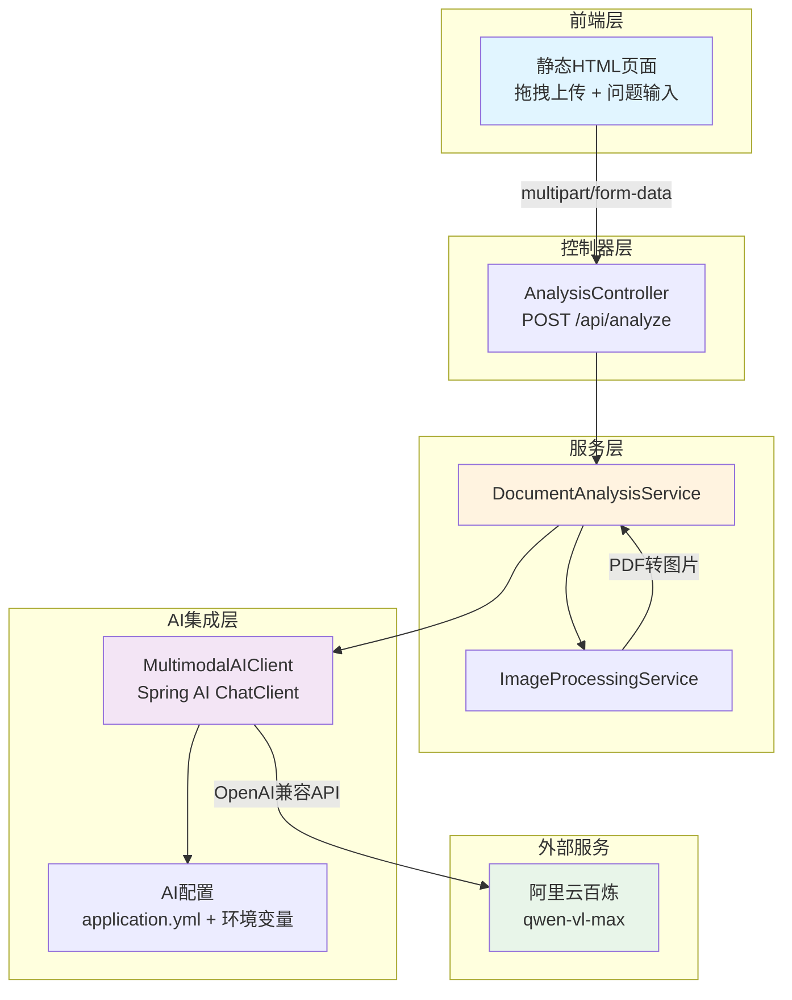

# 多模态文档分析 Agent

这是一个基于 Spring Boot 和 Spring AI 构建的智能文档分析系统，展现了现代 Java AI 应用开发的最佳实践。该项目作为技术作品集，展示了从零到一构建生产级 AI 应用的能力。

## 🎯 项目概述

本项目分四个阶段迭代开发：

- **Stage 1（当前阶段）**：基础多模态分析 - 图片/PDF 上传 + 视觉语言模型问答
- **Stage 2**：多模态 RAG - 集成 pgvector 向量数据库，实现文档检索增强生成
- **Stage 3**：Agent 工具调用 - 集成 OCR、表格提取、计算器、图表生成等工具
- **Stage 4**：评估与优化 - 准确率测试、性能优化、监控告警、容器化部署

## ✨ Stage 1 功能特性

- ✅ 支持多种图片格式（JPEG、PNG、GIF、WebP）
- ✅ 支持 PDF 文档分析（自动渲染为图片）
- ✅ 基于阿里云百炼 qwen-vl-max 视觉语言模型
- ✅ OpenAI 兼容接口，可一键切换至 GPT-4o
- ✅ 拖拽式上传的现代化前端界面
- ✅ 完整的错误处理和参数验证
- ✅ 单元测试和集成测试覆盖

## 🏗 系统架构



## 🔧 技术栈

| 类别 | 技术 | 版本 | 用途 |
|------|------|------|------|
| 核心框架 | Spring Boot | 3.2.0 | Web 应用框架 |
| 语言 | Java | 17+ | 开发语言 |
| AI 集成 | Spring AI | 1.0.0-M3 | AI 模型调用抽象层 |
| LLM 服务 | 阿里云百炼 | qwen-vl-max | 视觉语言模型 |
| PDF 处理 | Apache PDFBox | 3.0.1 | PDF 渲染 |
| 构建工具 | Maven | 3.9+ | 项目构建 |
| 测试框架 | JUnit 5 + Mockito | - | 单元/集成测试 |

## 🚀 快速开始

### 前置条件

- Java 17 或更高版本
- Maven 3.6 或更高版本
- 阿里云 DashScope API Key（[获取地址](https://dashscope.aliyun.com/)）

### 1. 克隆项目

```bash
git clone <repository-url>
cd image-text-analyzer
```

### 2. 配置 API Key

**方式一：环境变量（推荐）**

```bash
export DASHSCOPE_API_KEY="your-api-key-here"
```

**方式二：系统属性**

```bash
mvn spring-boot:run -DDASHSCOPE_API_KEY="your-api-key-here"
```

### 3. 启动应用

```bash
mvn spring-boot:run
```

应用将在 `http://localhost:8080` 启动。

### 4. 访问界面

在浏览器中打开：http://localhost:8080

## 📖 API 使用示例

### 分析图片

```bash
curl -X POST http://localhost:8080/api/analyze \
  -F "file=@example.jpg" \
  -F "question=这张图片中的内容是什么？"
```

### 分析 PDF

```bash
curl -X POST http://localhost:8080/api/analyze \
  -F "file=@document.pdf" \
  -F "question=请总结这个文档的主要内容"
```

### 响应示例

```json
{
  "answer": "这是一张包含技术架构图的图片，展示了...",
  "model": "qwen-vl-max",
  "latencyMs": 1523,
  "metadata": {
    "fileName": "example.jpg",
    "fileType": "image",
    "fileSize": 245632,
    "contentType": "image/jpeg"
  }
}
```

## 🧪 测试

### 运行所有测试

```bash
mvn test
```

### 运行集成测试

```bash
mvn verify
```

### 测试覆盖

- ✅ 图片处理服务单元测试
- ✅ PDF 处理服务单元测试
- ✅ AI 客户端参数验证测试
- ✅ 文档分析服务集成测试
- ✅ API 控制器集成测试

## 🔍 核心设计决策（面试要点）

### 1. 为什么选择 Spring AI？

- **统一抽象层**：降低模型切换成本，从阿里云切换到 OpenAI 仅需修改配置
- **生态集成**：与 Spring Boot 深度集成，简化配置和依赖注入
- **OpenAI 兼容**：支持多种 LLM 厂商，避免供应商锁定

### 2. PDF 处理策略

- 使用 PDFBox 将 PDF 页面渲染为图片（150 DPI）
- 限制前 10 页以避免 Token 超限和处理延迟
- 每页独立图片，充分利用 VLM 的多图分析能力

### 3. 可扩展性设计

**分层架构**：Controller → Service → AI Client，职责清晰
- Controller：处理 HTTP 请求和参数验证
- Service：业务逻辑协调
- AI Client：封装 AI 模型调用

**配置外部化**：模型名称、API 端点、文件限制等都可通过配置文件调整

**接口抽象**：为后续阶段预留扩展点
```java
// Stage 2: RAG 扩展
interface VectorStore {
    void store(Document doc);
    List<Document> search(String query);
}

// Stage 3: 工具调用扩展
interface AgentTool {
    String execute(Map<String, Object> params);
}
```

### 4. 错误处理策略

- **参数验证前置**：文件类型、大小在服务层提前验证
- **统一异常处理**：GlobalExceptionHandler 返回标准 JSON 错误格式
- **AI 调用容错**：Spring AI 内置超时和重试机制
- **安全考虑**：API Key 仅从环境变量读取，错误信息脱敏

### 5. 测试策略

- **单元测试**：使用 Mockito 模拟依赖，测试业务逻辑
- **集成测试**：使用 `@WebMvcTest` 测试 API 端点
- **无 API Key 测试**：Mock AI 客户端，避免测试依赖外部服务

## 📁 项目结构

```
image-text-analyzer/
├── src/
│   ├── main/
│   │   ├── java/com/portfolio/analyzer/
│   │   │   ├── AnalyzerApplication.java          # 启动类
│   │   │   ├── config/
│   │   │   │   └── AIConfig.java                # AI 配置
│   │   │   ├── controller/
│   │   │   │   └── AnalysisController.java      # API 控制器
│   │   │   ├── service/
│   │   │   │   ├── DocumentAnalysisService.java # 文档分析服务
│   │   │   │   └── ImageProcessingService.java  # 图片处理服务
│   │   │   ├── ai/
│   │   │   │   └── MultimodalAIClient.java      # AI 客户端封装
│   │   │   ├── dto/
│   │   │   │   └── AnalysisResponse.java        # 响应 DTO
│   │   │   └── exception/
│   │   │       ├── GlobalExceptionHandler.java  # 全局异常处理
│   │   │       ├── InvalidFileTypeException.java
│   │   │       ├── FileSizeLimitException.java
│   │   │       └── AIServiceException.java
│   │   └── resources/
│   │       ├── application.yml                   # 应用配置
│   │       └── static/
│   │           └── index.html                    # 前端页面
│   └── test/
│       ├── java/com/portfolio/analyzer/
│       │   ├── service/
│       │   │   ├── ImageProcessingServiceTest.java
│       │   │   └── DocumentAnalysisServiceTest.java
│       │   ├── ai/
│       │   │   └── MultimodalAIClientTest.java
│       │   ├── controller/
│       │   │   └── AnalysisControllerTest.java
│       │   └── TestDataGenerator.java           # 测试数据生成器
│       └── resources/
│           ├── test-data/                        # 测试数据
│           └── application-test.yml              # 测试配置
├── pom.xml
├── .gitignore
├── README.md
└── 文档-多模态文档分析Agent设计.md          # 详细设计文档
```

## 🗺 开发路线图

### Stage 2: 多模态 RAG（计划中）

- [ ] 集成 PostgreSQL + pgvector 向量数据库
- [ ] 实现文档分块和向量化（文本 + 图片）
- [ ] 构建检索增强生成（RAG）流程
- [ ] 添加历史对话管理

**技术要点**：
- 使用 Spring Data JPA + pgvector 扩展
- 文本和图片混合向量检索
- 相关性排序和重排序（Reranking）

### Stage 3: Agent 工具调用（计划中）

- [ ] OCR 工具：Tess4J 提取图片中的文字
- [ ] 表格提取：识别表格结构并转为结构化数据
- [ ] 计算器：处理数学表达式计算
- [ ] 图表生成：根据数据生成可视化图表

**技术要点**：
- Spring AI 的 Function Calling 机制
- 工具调用的可观测性（tracing）
- 多工具协同决策

### Stage 4: 评估与优化（计划中）

- [ ] 构建测试集并评估准确率
- [ ] 添加缓存机制（Redis）减少重复调用
- [ ] 实现批处理提高吞吐量
- [ ] 添加监控和日志（Prometheus + Grafana）
- [ ] Docker 容器化和云部署

**技术要点**：
- 使用 LangSmith/Weights & Biases 进行评估
- Redis 缓存策略
- 容器化部署最佳实践

## 🔐 安全说明

- ⚠️ **切勿将 API Key 提交到代码仓库**
- ✅ 始终使用环境变量或密钥管理服务
- ✅ 文件上传限制：最大 10MB，仅支持图片和 PDF
- ✅ 错误信息中不包含敏感信息（API Key、内部路径等）

## 📝 配置说明

### 核心配置项（application.yml）

```yaml
spring:
  ai:
    openai:
      base-url: https://dashscope.aliyuncs.com/compatible-mode/v1  # API 端点
      api-key: ${DASHSCOPE_API_KEY}                                # API Key
      chat:
        options:
          model: qwen-vl-max                                       # 模型名称
          temperature: 0.7                                         # 温度参数

app:
  analysis:
    max-pdf-pages: 10           # PDF 最大页数
    max-file-size-mb: 10        # 文件最大大小（MB）
    pdf-render-dpi: 150         # PDF 渲染 DPI
```

### 切换到 OpenAI GPT-4o

修改 `application.yml`：

```yaml
spring:
  ai:
    openai:
      base-url: https://api.openai.com/v1
      api-key: ${OPENAI_API_KEY}
      chat:
        options:
          model: gpt-4o
```

## 🤝 贡献指南

欢迎提交 Issue 和 Pull Request！

## 📄 许可证

MIT License

## 📧 联系方式

- 项目作者：[您的名字]
- 邮箱：[您的邮箱]
- GitHub：[您的 GitHub]

---

**⭐ 如果这个项目对你有帮助，请给一个 Star！**
