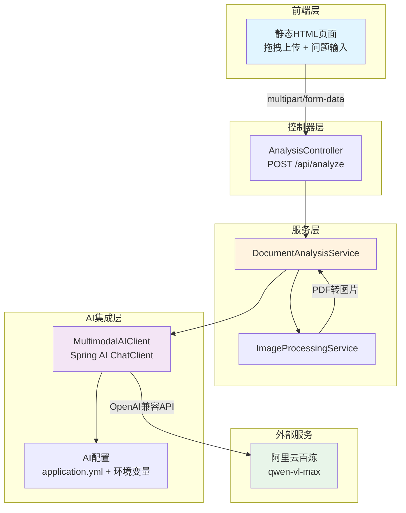
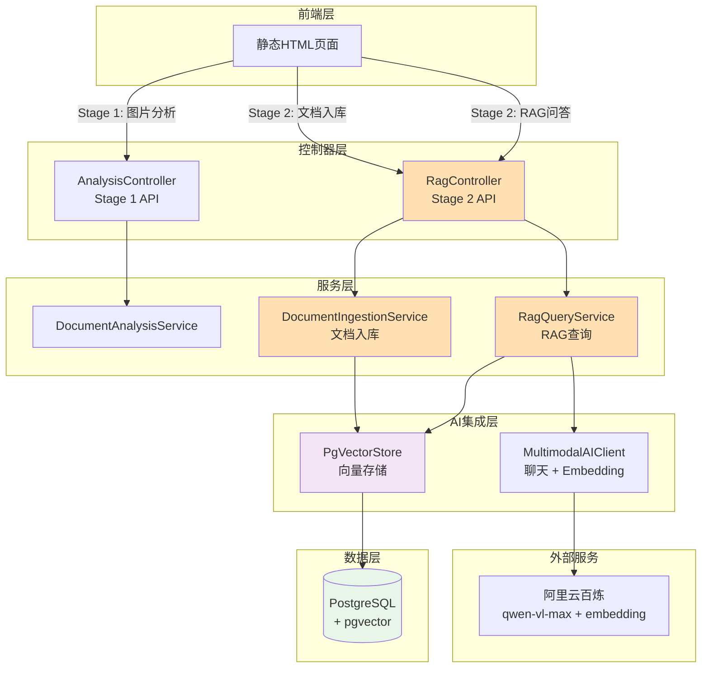

# 多模态文档分析Agent - 设计文档

## 项目概述

这是一个基于Java + Spring Boot的作品集项目，展示现代AI应用开发能力。项目分四个阶段迭代：
- **Stage 1（已完成）**：基础多模态分析 - 图片/PDF上传 + 视觉语言模型问答
- **Stage 2（当前）**：多模态RAG - 集成pgvector向量数据库，实现检索增强生成
- Stage 3：Agent工具调用 - OCR、表格提取、计算器、图表生成
- Stage 4：评估与优化

## Stage 1 架构设计

### 技术栈
- **核心框架**：Spring Boot 3.x + Java 17
- **AI集成**：Spring AI (OpenAI-compatible chat client)
- **LLM服务**：阿里云百炼/DashScope (qwen-vl-max模型)
- **PDF处理**：Apache PDFBox
- **构建工具**：Maven
- **测试**：JUnit 5 + Mockito + Spring Boot Test

### 架构图



### 核心模块设计

#### 1. 配置模块 (config/)
```
AIConfig
- 读取环境变量 DASHSCOPE_API_KEY
- 配置 Spring AI ChatClient
- 支持模型/端点切换（application.yml）
```

#### 2. 控制器模块 (controller/)
```
AnalysisController
- POST /api/analyze
  - 接收参数：MultipartFile file, String question
  - 验证：文件类型（image/*, application/pdf）、大小限制（10MB）
  - 返回：AnalysisResponse (answer, model, latencyMs, metadata)
```

#### 3. 服务模块 (service/)
```
DocumentAnalysisService（主服务）
- analyzeDocument(file, question) → AnalysisResult
- 协调图片处理和AI调用

ImageProcessingService
- processImage(MultipartFile) → List<byte[]>
- processPdf(MultipartFile) → List<byte[]>（限制前10页）
- 使用PDFBox渲染PDF为图片
```

#### 4. AI客户端 (ai/)
```
MultimodalAIClient
- analyzeImages(images, question) → String
- 封装Spring AI ChatClient
- 支持多图片输入
- 错误处理和重试
```

#### 5. DTO模块 (dto/)
```
AnalysisRequest
- MultipartFile file
- String question

AnalysisResponse
- String answer
- String model
- long latencyMs
- Map<String, Object> metadata
```

#### 6. 异常处理
```
GlobalExceptionHandler
- InvalidFileTypeException
- FileSizeLimitException
- AIServiceException
- 返回统一错误格式
```

### 配置文件设计

**application.yml**
```yaml
spring:
  servlet:
    multipart:
      max-file-size: 10MB
      max-request-size: 10MB
  ai:
    openai:
      base-url: https://dashscope.aliyuncs.com/compatible-mode/v1
      api-key: ${DASHSCOPE_API_KEY}
      chat:
        options:
          model: qwen-vl-max

app:
  analysis:
    max-pdf-pages: 10
    supported-image-types: image/jpeg,image/png,image/gif,image/webp
    supported-file-types: image/jpeg,image/png,image/gif,image/webp,application/pdf
```

### 前端设计

**单页面HTML（resources/static/index.html）**
- 拖拽区域（支持图片和PDF）
- 文件预览（图片显示缩略图，PDF显示图标）
- 问题输入框（多行文本）
- 提交按钮
- 结果展示区域（答案 + 元数据）
- 加载状态指示
- 中文UI

### 测试策略

#### 单元测试
- `ImageProcessingServiceTest`：测试图片/PDF处理逻辑
- `MultimodalAIClientTest`：Mock ChatClient测试AI调用
- `DocumentAnalysisServiceTest`：集成服务层测试

#### 集成测试
- `AnalysisControllerTest`：
  - Mock服务层
  - 测试文件上传
  - 测试验证逻辑
  - 测试错误处理

#### 测试数据
- 准备测试图片（test.jpg）
- 准备测试PDF（test.pdf）
- Mock AI响应数据

### 关键设计决策（面试要点）

#### 1. 为什么选择Spring AI？
- 统一抽象层，降低模型切换成本
- OpenAI兼容协议支持多厂商（阿里云、OpenAI、Azure）
- Spring生态集成，简化配置和依赖注入

#### 2. PDF处理策略
- 使用PDFBox将PDF页面渲染为图片（DPI 150）
- 限制10页避免Token超限和处理延迟
- 每页独立图片，利用VLM多图能力

#### 3. 可扩展性设计
- **服务分层**：Controller → Service → AI Client，各层职责清晰
- **配置外部化**：模型、端点、限制都可配置
- **接口抽象**：为Stage 2的RAG和Stage 3的工具调用预留扩展点
  ```java
  // 未来扩展
  interface DocumentProcessor {
      List<byte[]> process(MultipartFile file);
  }
  
  interface AIAgent {
      String analyze(AnalysisContext context);
  }
  ```

#### 4. 错误处理策略
- 文件验证前置（类型、大小）
- AI调用超时和重试（Spring AI内置）
- 统一异常处理返回标准JSON
- 敏感信息脱敏（API Key不输出）

#### 5. 安全考虑
- API Key仅从环境变量读取
- 文件类型白名单验证
- 文件大小限制
- 上传文件临时存储（不持久化敏感数据）

### 项目结构
```
image-text-analyzer/
├── src/
│   ├── main/
│   │   ├── java/com/portfolio/analyzer/
│   │   │   ├── AnalyzerApplication.java
│   │   │   ├── config/
│   │   │   │   └── AIConfig.java
│   │   │   ├── controller/
│   │   │   │   └── AnalysisController.java
│   │   │   ├── service/
│   │   │   │   ├── DocumentAnalysisService.java
│   │   │   │   └── ImageProcessingService.java
│   │   │   ├── ai/
│   │   │   │   └── MultimodalAIClient.java
│   │   │   ├── dto/
│   │   │   │   ├── AnalysisRequest.java
│   │   │   │   └── AnalysisResponse.java
│   │   │   └── exception/
│   │   │       ├── GlobalExceptionHandler.java
│   │   │       ├── InvalidFileTypeException.java
│   │   │       ├── FileSizeLimitException.java
│   │   │       └── AIServiceException.java
│   │   └── resources/
│   │       ├── application.yml
│   │       ├── application-test.yml
│   │       └── static/
│   │           └── index.html
│   └── test/
│       ├── java/com/portfolio/analyzer/
│       │   ├── service/
│       │   │   ├── ImageProcessingServiceTest.java
│       │   │   └── DocumentAnalysisServiceTest.java
│       │   ├── ai/
│       │   │   └── MultimodalAIClientTest.java
│       │   └── controller/
│       │       └── AnalysisControllerTest.java
│       └── resources/
│           ├── test-data/
│           │   ├── test.jpg
│           │   └── test.pdf
│           └── application-test.yml
├── pom.xml
├── .gitignore
└── README.md
```

---

## Stage 2 架构设计（当前阶段）

### 技术栈更新
在 Stage 1 基础上新增：
- **向量数据库**：PostgreSQL + pgvector extension (pg16)
- **ORM框架**：Spring Data JPA
- **Embedding服务**：阿里云百炼 text-embedding-v3 (1536维)
- **文档切块**：Spring AI TokenTextSplitter
- **容器化**：Docker Compose（本地开发环境）

### 架构图（Stage 2 扩展）



### 核心模块设计（Stage 2 新增）

#### 1. 配置模块扩展 (config/)
```
RagConfig（新增）
- chunk-size: 500（文档切块大小）
- chunk-overlap: 50（切块重叠）
- top-k: 3（检索返回数量）
- similarity-threshold: 0.7（相似度阈值）
```

#### 2. 控制器模块扩展 (controller/)
```
RagController（新增）
- POST /api/rag/ingest
  - 接收参数：MultipartFile file, String source
  - 功能：文档切块 + Embedding + 入库
  - 返回：IngestResponse (chunksProcessed, processingTimeMs)

- POST /api/rag/query
  - 接收参数：RagQueryRequest (question, conversationId)
  - 功能：向量检索 + 上下文增强 + LLM生成
  - 返回：RagQueryResponse (answer, sources[], model, latencyMs)
```

#### 3. 服务模块扩展 (service/)
```
DocumentIngestionService（新增）
- ingestDocument(file, source) → int
  - 读取文件内容（UTF-8编码）
  - TokenTextSplitter切块（500 token，50 overlap）
  - 添加元数据（source, fileName, contentType）
  - 调用 VectorStore.add() 批量入库
  - 返回处理的chunk数量

RagQueryService（新增）
- queryWithContext(question) → RagQueryResponse
  - 构建 SearchRequest（topK=3）
  - VectorStore.similaritySearch() 检索
  - 过滤低相似度文档（threshold=0.7）
  - 构建增强Prompt（上下文 + 问题）
  - 调用 AIClient.chat() 生成答案
  - 返回答案和引用来源
```

#### 4. AI客户端扩展 (ai/)
```
MultimodalAIClient（扩展）
- chat(prompt) → String（新增）
  - 纯文本聊天（用于RAG场景）
  - 支持长上下文输入
  - 统一错误处理
```

#### 5. DTO模块扩展 (dto/)
```
IngestRequest（新增）
- String content
- String source
- String metadata

IngestResponse（新增）
- String message
- int chunksProcessed
- long processingTimeMs

RagQueryRequest（新增）
- String question
- String conversationId（可选，预留）

RagQueryResponse（新增）
- String answer
- List<DocumentSource> sources
- String model
- long latencyMs

DocumentSource（内嵌类）
- String content（文档片段）
- String source（来源标识）
- double similarity（相似度分数）
- Map<String, Object> metadata
```

### 数据库设计

#### pgvector 向量表（由 Spring AI 自动创建）
```sql
CREATE TABLE vector_store (
    id VARCHAR(255) PRIMARY KEY,
    content TEXT,
    metadata JSON,
    embedding vector(1536)  -- text-embedding-v3 维度
);

CREATE INDEX ON vector_store 
USING hnsw (embedding vector_cosine_ops);
```

### 配置文件（application.yml 完整版）

```yaml
spring:
  application:
    name: image-text-analyzer
  
  # 文件上传配置
  servlet:
    multipart:
      max-file-size: 10MB
      max-request-size: 10MB
      enabled: true
  
  # AI 配置
  ai:
    openai:
      base-url: https://dashscope.aliyuncs.com/compatible-mode/v1
      api-key: ${DASHSCOPE_API_KEY:dummy-key-for-test}
      chat:
        options:
          model: qwen-vl-max
          temperature: 0.7
      embedding:
        options:
          model: text-embedding-v3
    vectorstore:
      pgvector:
        index-type: HNSW
        distance-type: COSINE_DISTANCE
        dimensions: 1536
  
  # 数据库配置（Stage 2）
  datasource:
    url: jdbc:postgresql://${DB_HOST:localhost}:${DB_PORT:5432}/${DB_NAME:analyzer_db}
    username: ${DB_USER:analyzer}
    password: ${DB_PASSWORD:analyzer_pass}
    driver-class-name: org.postgresql.Driver
  
  jpa:
    hibernate:
      ddl-auto: update
    show-sql: false
    properties:
      hibernate:
        dialect: org.hibernate.dialect.PostgreSQLDialect

# 应用配置
app:
  analysis:
    max-pdf-pages: 10
    max-file-size-mb: 10
    supported-image-types: image/jpeg,image/png,image/gif,image/webp,image/jpg
    supported-file-types: image/jpeg,image/png,image/gif,image/webp,image/jpg,application/pdf
    pdf-render-dpi: 150
  
  rag:
    chunk-size: 500
    chunk-overlap: 50
    top-k: 3
    similarity-threshold: 0.7

server:
  port: 8080

logging:
  level:
    com.portfolio.analyzer: INFO
    org.springframework.ai: DEBUG
```

### Docker Compose 配置

```yaml
version: '3.8'

services:
  postgres:
    image: pgvector/pgvector:pg16
    container_name: image-text-analyzer-pgvector
    environment:
      POSTGRES_DB: analyzer_db
      POSTGRES_USER: analyzer
      POSTGRES_PASSWORD: analyzer_pass
    ports:
      - "5432:5432"
    volumes:
      - pgvector_data:/var/lib/postgresql/data
    healthcheck:
      test: ["CMD-SHELL", "pg_isready -U analyzer -d analyzer_db"]
      interval: 10s
      timeout: 5s
      retries: 5
    networks:
      - analyzer_network

volumes:
  pgvector_data:

networks:
  analyzer_network:
    driver: bridge
```

### RAG 流程设计

#### 文档入库流程
```
1. 接收文档上传（/api/rag/ingest）
   ↓
2. 读取文档内容（UTF-8 编码）
   ↓
3. TokenTextSplitter 切块
   - chunk_size: 500 tokens
   - overlap: 50 tokens
   ↓
4. 为每个 chunk 添加元数据
   - source: 文档来源
   - fileName: 原始文件名
   - contentType: 文件类型
   ↓
5. 调用 Embedding API 向量化
   - 模型: text-embedding-v3
   - 维度: 1536
   ↓
6. 批量写入 pgvector
   ↓
7. 返回成功响应（chunk数量、耗时）
```

#### RAG 查询流程
```
1. 接收用户问题（/api/rag/query）
   ↓
2. 问题向量化（Embedding）
   ↓
3. pgvector 相似度检索
   - 算法: HNSW + COSINE_DISTANCE
   - topK: 3
   ↓
4. 过滤低相似度结果
   - threshold: 0.7 (similarity = 1 - distance)
   ↓
5. 构建增强 Prompt
   - 模板: "基于以下上下文回答问题..."
   - 拼接检索到的文档片段
   ↓
6. 调用 LLM 生成答案
   - 模型: qwen-vl-max
   ↓
7. 返回答案 + 引用来源
   - answer: LLM 生成的答案
   - sources: 引用的文档片段列表
     - content: 片段内容
     - source: 来源标识
     - similarity: 相似度分数
```

### 关键技术决策

#### 1. 为什么使用 TokenTextSplitter？
- **Token 对齐**：与 LLM 的 token 计数一致，避免超出上下文窗口
- **语义保留**：通过 overlap 保持跨块的语义连续性
- **可配置**：chunk_size 和 overlap 可根据实际场景调整

#### 2. 为什么选择 HNSW 索引？
- **高性能**：近似最近邻（ANN）算法，查询速度快
- **高精度**：召回率高（> 95%）
- **pgvector 原生支持**：无需额外依赖

#### 3. 为什么使用 COSINE_DISTANCE？
- **归一化**：不受向量长度影响，只关注方向
- **语义相似度**：适合文本向量相似度计算
- **业界标准**：OpenAI、Pinecone 等都使用余弦相似度

#### 4. 相似度阈值设计
- **threshold = 0.7**：过滤掉低相关文档，提高答案质量
- **可调**：通过配置文件调整，适应不同业务场景
- **计算**：similarity = 1 - distance (pgvector 返回的是距离)

#### 5. Stage 1 兼容性
- **独立路由**：Stage 2 使用 `/api/rag/*`，不影响 `/api/analyze`
- **独立服务**：新增的 Service 不修改原有代码
- **配置隔离**：RAG 配置在 `app.rag` 命名空间下

### 测试策略（Stage 2）

#### 1. 单元测试
- **DocumentIngestionServiceTest**
  - 测试文档切块（正常、空文件、超大文件）
  - 测试元数据生成
  - Mock VectorStore，验证调用参数
  
- **RagQueryServiceTest**
  - 测试检索逻辑（有结果、无结果）
  - 测试相似度过滤
  - 测试 Prompt 构建
  - Mock VectorStore 和 AIClient

#### 2. 集成测试
- **RagControllerTest**
  - 测试入库 API（成功、文件为空）
  - 测试查询 API（成功、问题为空）
  - 使用 @WebMvcTest Mock 服务层

#### 3. 手动测试
- 启动 pgvector（docker compose up）
- 入库测试文档
- 验证检索结果
- 验证答案质量和引用准确性

### Stage 2-4 路线图（简要）

#### Stage 2: 多模态RAG
- 集成pgvector（PostgreSQL）
- 文档分块和向量化（文本+图片）
- 检索增强生成
- 历史对话管理

#### Stage 3: Agent工具调用
- OCR工具：Tess4J提取文字
- 表格提取：表格识别和结构化
- 计算器：数学表达式计算
- 图表生成：基于数据生成可视化

#### Stage 4: 评估与优化
- 准确率评估（测试集）
- 性能优化（缓存、批处理）
- 监控和日志
- 部署方案（Docker + 云服务）

## 实现检查清单

### 功能完成
- [ ] Maven项目结构创建
- [ ] Spring Boot应用启动类
- [ ] AI配置（Spring AI + DashScope）
- [ ] 图片处理服务
- [ ] PDF处理服务（PDFBox）
- [ ] AI客户端（Spring AI封装）
- [ ] 文档分析服务
- [ ] API控制器（/api/analyze）
- [ ] 请求/响应DTO
- [ ] 异常处理
- [ ] 前端页面（拖拽上传）

### 测试完成
- [ ] 图片处理单元测试
- [ ] PDF处理单元测试
- [ ] AI客户端测试（Mock）
- [ ] 服务层测试
- [ ] 控制器集成测试
- [ ] mvn verify通过

### 文档完成
- [ ] README.md（中文）
  - [ ] 项目介绍
  - [ ] 架构图
  - [ ] 本地运行指南
  - [ ] API示例（curl）
  - [ ] Stage 2-4路线图
- [ ] .gitignore更新

### 代码质量
- [ ] 代码注释（关键逻辑）
- [ ] 异常处理完善
- [ ] 配置项文档化
- [ ] 日志记录（INFO级别）

---

## Stage 2 实现检查清单

### 功能完成
- ✅ Docker Compose 配置（pgvector）
- ✅ Maven 依赖更新（pgvector、Spring AI）
- ✅ 数据库配置（application.yml）
- ✅ RAG 配置类（RagConfig）
- ✅ 文档入库服务（DocumentIngestionService）
- ✅ RAG 查询服务（RagQueryService）
- ✅ RAG 控制器（RagController）
- ✅ DTO 类（IngestRequest/Response, RagQueryRequest/Response）
- ✅ AI 客户端扩展（chat 方法）

### 测试完成
- ✅ 文档入库服务单元测试（5个测试用例）
- ✅ RAG 查询服务单元测试（6个测试用例）
- ✅ RAG 控制器集成测试（6个测试用例）
- ✅ mvn test 通过（37个测试全部通过）
- ✅ mvn verify 通过

### 文档完成
- ✅ README.md 更新
  - ✅ Stage 2 功能特性
  - ✅ 启动步骤（包含 docker compose）
  - ✅ API 使用示例（入库、查询）
  - ✅ 技术栈表格
  - ✅ 配置说明
  - ✅ 项目结构
- ✅ 设计文档更新（Stage 2 架构设计）

### 代码质量
- ✅ 遵循 TDD 模式（先测试后实现）
- ✅ 完整的日志记录
- ✅ 参数验证和异常处理
- ✅ API Key 仅从环境变量读取
- ✅ Stage 1 功能保持完全可用

---

**最后更新时间**: 2026-10-16  
**当前阶段**: Stage 2 已完成，准备提交 PR
