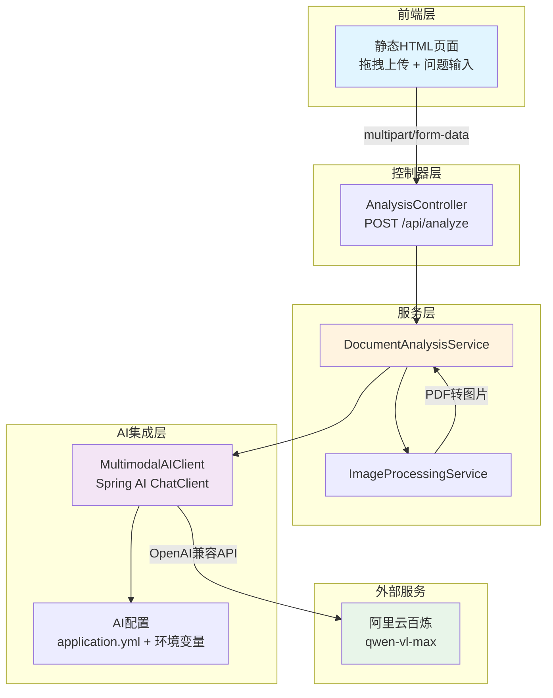

# 多模态文档分析Agent - 设计文档

## 项目概述

这是一个基于Java + Spring Boot的作品集项目，展示现代AI应用开发能力。项目分四个阶段迭代：
- **Stage 1（当前）**：基础多模态分析 - 图片/PDF上传 + 视觉语言模型问答
- Stage 2：多模态RAG - 集成pgvector向量数据库
- Stage 3：Agent工具调用 - OCR、表格提取、计算器、图表生成
- Stage 4：评估与优化

## Stage 1 架构设计

### 技术栈
- **核心框架**：Spring Boot 3.x + Java 17
- **AI集成**：Spring AI (OpenAI-compatible chat client)
- **LLM服务**：阿里云百炼/DashScope (qwen-vl-max模型)
- **PDF处理**：Apache PDFBox
- **构建工具**：Maven
- **测试**：JUnit 5 + Mockito + Spring Boot Test

### 架构图



### 核心模块设计

#### 1. 配置模块 (config/)
```
AIConfig
- 读取环境变量 DASHSCOPE_API_KEY
- 配置 Spring AI ChatClient
- 支持模型/端点切换（application.yml）
```

#### 2. 控制器模块 (controller/)
```
AnalysisController
- POST /api/analyze
  - 接收参数：MultipartFile file, String question
  - 验证：文件类型（image/*, application/pdf）、大小限制（10MB）
  - 返回：AnalysisResponse (answer, model, latencyMs, metadata)
```

#### 3. 服务模块 (service/)
```
DocumentAnalysisService（主服务）
- analyzeDocument(file, question) → AnalysisResult
- 协调图片处理和AI调用

ImageProcessingService
- processImage(MultipartFile) → List<byte[]>
- processPdf(MultipartFile) → List<byte[]>（限制前10页）
- 使用PDFBox渲染PDF为图片
```

#### 4. AI客户端 (ai/)
```
MultimodalAIClient
- analyzeImages(images, question) → String
- 封装Spring AI ChatClient
- 支持多图片输入
- 错误处理和重试
```

#### 5. DTO模块 (dto/)
```
AnalysisRequest
- MultipartFile file
- String question

AnalysisResponse
- String answer
- String model
- long latencyMs
- Map<String, Object> metadata
```

#### 6. 异常处理
```
GlobalExceptionHandler
- InvalidFileTypeException
- FileSizeLimitException
- AIServiceException
- 返回统一错误格式
```

### 配置文件设计

**application.yml**
```yaml
spring:
  servlet:
    multipart:
      max-file-size: 10MB
      max-request-size: 10MB
  ai:
    openai:
      base-url: https://dashscope.aliyuncs.com/compatible-mode/v1
      api-key: ${DASHSCOPE_API_KEY}
      chat:
        options:
          model: qwen-vl-max

app:
  analysis:
    max-pdf-pages: 10
    supported-image-types: image/jpeg,image/png,image/gif,image/webp
    supported-file-types: image/jpeg,image/png,image/gif,image/webp,application/pdf
```

### 前端设计

**单页面HTML（resources/static/index.html）**
- 拖拽区域（支持图片和PDF）
- 文件预览（图片显示缩略图，PDF显示图标）
- 问题输入框（多行文本）
- 提交按钮
- 结果展示区域（答案 + 元数据）
- 加载状态指示
- 中文UI

### 测试策略

#### 单元测试
- `ImageProcessingServiceTest`：测试图片/PDF处理逻辑
- `MultimodalAIClientTest`：Mock ChatClient测试AI调用
- `DocumentAnalysisServiceTest`：集成服务层测试

#### 集成测试
- `AnalysisControllerTest`：
  - Mock服务层
  - 测试文件上传
  - 测试验证逻辑
  - 测试错误处理

#### 测试数据
- 准备测试图片（test.jpg）
- 准备测试PDF（test.pdf）
- Mock AI响应数据

### 关键设计决策（面试要点）

#### 1. 为什么选择Spring AI？
- 统一抽象层，降低模型切换成本
- OpenAI兼容协议支持多厂商（阿里云、OpenAI、Azure）
- Spring生态集成，简化配置和依赖注入

#### 2. PDF处理策略
- 使用PDFBox将PDF页面渲染为图片（DPI 150）
- 限制10页避免Token超限和处理延迟
- 每页独立图片，利用VLM多图能力

#### 3. 可扩展性设计
- **服务分层**：Controller → Service → AI Client，各层职责清晰
- **配置外部化**：模型、端点、限制都可配置
- **接口抽象**：为Stage 2的RAG和Stage 3的工具调用预留扩展点
  ```java
  // 未来扩展
  interface DocumentProcessor {
      List<byte[]> process(MultipartFile file);
  }
  
  interface AIAgent {
      String analyze(AnalysisContext context);
  }
  ```

#### 4. 错误处理策略
- 文件验证前置（类型、大小）
- AI调用超时和重试（Spring AI内置）
- 统一异常处理返回标准JSON
- 敏感信息脱敏（API Key不输出）

#### 5. 安全考虑
- API Key仅从环境变量读取
- 文件类型白名单验证
- 文件大小限制
- 上传文件临时存储（不持久化敏感数据）

### 项目结构
```
image-text-analyzer/
├── src/
│   ├── main/
│   │   ├── java/com/portfolio/analyzer/
│   │   │   ├── AnalyzerApplication.java
│   │   │   ├── config/
│   │   │   │   └── AIConfig.java
│   │   │   ├── controller/
│   │   │   │   └── AnalysisController.java
│   │   │   ├── service/
│   │   │   │   ├── DocumentAnalysisService.java
│   │   │   │   └── ImageProcessingService.java
│   │   │   ├── ai/
│   │   │   │   └── MultimodalAIClient.java
│   │   │   ├── dto/
│   │   │   │   ├── AnalysisRequest.java
│   │   │   │   └── AnalysisResponse.java
│   │   │   └── exception/
│   │   │       ├── GlobalExceptionHandler.java
│   │   │       ├── InvalidFileTypeException.java
│   │   │       ├── FileSizeLimitException.java
│   │   │       └── AIServiceException.java
│   │   └── resources/
│   │       ├── application.yml
│   │       ├── application-test.yml
│   │       └── static/
│   │           └── index.html
│   └── test/
│       ├── java/com/portfolio/analyzer/
│       │   ├── service/
│       │   │   ├── ImageProcessingServiceTest.java
│       │   │   └── DocumentAnalysisServiceTest.java
│       │   ├── ai/
│       │   │   └── MultimodalAIClientTest.java
│       │   └── controller/
│       │       └── AnalysisControllerTest.java
│       └── resources/
│           ├── test-data/
│           │   ├── test.jpg
│           │   └── test.pdf
│           └── application-test.yml
├── pom.xml
├── .gitignore
└── README.md
```

### Stage 2-4 路线图（简要）

#### Stage 2: 多模态RAG
- 集成pgvector（PostgreSQL）
- 文档分块和向量化（文本+图片）
- 检索增强生成
- 历史对话管理

#### Stage 3: Agent工具调用
- OCR工具：Tess4J提取文字
- 表格提取：表格识别和结构化
- 计算器：数学表达式计算
- 图表生成：基于数据生成可视化

#### Stage 4: 评估与优化
- 准确率评估（测试集）
- 性能优化（缓存、批处理）
- 监控和日志
- 部署方案（Docker + 云服务）

## 实现检查清单

### 功能完成
- [ ] Maven项目结构创建
- [ ] Spring Boot应用启动类
- [ ] AI配置（Spring AI + DashScope）
- [ ] 图片处理服务
- [ ] PDF处理服务（PDFBox）
- [ ] AI客户端（Spring AI封装）
- [ ] 文档分析服务
- [ ] API控制器（/api/analyze）
- [ ] 请求/响应DTO
- [ ] 异常处理
- [ ] 前端页面（拖拽上传）

### 测试完成
- [ ] 图片处理单元测试
- [ ] PDF处理单元测试
- [ ] AI客户端测试（Mock）
- [ ] 服务层测试
- [ ] 控制器集成测试
- [ ] mvn verify通过

### 文档完成
- [ ] README.md（中文）
  - [ ] 项目介绍
  - [ ] 架构图
  - [ ] 本地运行指南
  - [ ] API示例（curl）
  - [ ] Stage 2-4路线图
- [ ] .gitignore更新

### 代码质量
- [ ] 代码注释（关键逻辑）
- [ ] 异常处理完善
- [ ] 配置项文档化
- [ ] 日志记录（INFO级别）

---

## API 规范底座设计（BE-1）

### 实现概述

**目标**：建立企业级 API 规范底座，为后续 Stage 2 RAG 和 Stage 3 Agent 工具调用奠定基础。

**核心功能**：
1. ✅ 路由版本化：`/api/v1/analyze`（新版本），`/api/analyze`（旧版本保留兼容）
2. ✅ 统一响应体：`{code, message, data, traceId}`
3. ✅ 全局异常处理 + 错误码枚举
4. ✅ 请求日志过滤器：MDC traceId + 结构化 JSON 日志
5. ✅ Bean Validation 参数校验

### 新增文件

```
src/main/java/com/portfolio/analyzer/
├── common/
│   ├── ErrorCode.java                 # 错误码枚举
│   └── ApiResponse.java               # 统一响应体
├── filter/
│   └── TraceIdFilter.java             # TraceId 过滤器
└── exception/
    └── ModelTimeoutException.java     # 模型超时异常

src/main/resources/
└── logback-spring.xml                 # Logback 配置（JSON/可读格式切换）
```

### 修改文件

```
src/main/java/com/portfolio/analyzer/
├── controller/
│   └── AnalysisController.java        # 支持 v1 和旧版接口
└── exception/
    └── GlobalExceptionHandler.java    # 使用统一响应体和错误码

src/main/resources/
└── static/
    └── index.html                     # 前端调用新版接口

pom.xml                                # 添加 logstash-logback-encoder 依赖
```

### 错误码设计

**格式**：`E + HTTP状态码 + 两位序号`

| 错误码 | HTTP 状态 | 说明 |
|--------|----------|------|
| 00000 | 200 | 成功 |
| E40001 | 400 | 参数校验失败 |
| E40002 | 400 | 文件不能为空 |
| E40003 | 400 | 问题不能为空 |
| E40801 | 408 | 请求超时 |
| E41301 | 413 | 文件大小超过限制 |
| E41501 | 415 | 不支持的文件类型 |
| E42901 | 429 | 请求过于频繁（预留） |
| E50001 | 500 | 服务器内部错误 |
| E50002 | 500 | AI服务调用失败 |
| E50201 | 502 | 模型服务异常 |
| E50401 | 504 | 模型调用超时 |

### TraceId 设计

**实现原理**：
1. `TraceIdFilter` 拦截所有请求
2. 从请求头 `X-Request-Id` 获取 traceId，没有则生成 UUID
3. 放入 MDC（Mapped Diagnostic Context）
4. 响应头 `X-Trace-Id` 返回 traceId
5. 请求结束时清理 MDC

**日志示例**：

开发环境（可读格式）：
```
2026-10-19 10:23:45.123 [http-nio-8080-exec-1] [abc123def456] INFO  c.p.a.controller.AnalysisController - Received analysis request (v1): file=test.jpg, question=测试
```

生产环境（JSON 格式）：
```json
{
  "timestamp": "2026-10-19T10:23:45.123Z",
  "level": "INFO",
  "thread": "http-nio-8080-exec-1",
  "logger": "c.p.a.controller.AnalysisController",
  "message": "Received analysis request (v1): file=test.jpg, question=测试",
  "traceId": "abc123def456",
  "app": "image-text-analyzer"
}
```

### 版本化策略

**废弃接口 `/api/analyze`**：
- 返回 `Deprecation: true` 头
- 返回 `Sunset: Thu, 31 Dec 2026 23:59:59 GMT` 头
- 返回 `Link: </api/v1/analyze>; rel="successor-version"` 头
- 功能与新接口完全一致，便于客户端平滑迁移

**推荐接口 `/api/v1/analyze`**：
- 无废弃标记
- 统一响应体格式
- 自动 traceId 追踪

### 测试覆盖

**新增测试用例**（`AnalysisControllerTest`）：
- ✅ v1 接口成功响应包含 traceId
- ✅ 自定义 X-Request-Id 原样透传
- ✅ 旧接口返回 Deprecation 头
- ✅ 文件为空返回 E40002
- ✅ 问题为空返回 E40003
- ✅ 文件类型不支持返回 E41501
- ✅ 文件过大返回 E41301
- ✅ AI 服务错误返回 E50002
- ✅ 模型超时返回 E50401
- ✅ 未知异常返回 E50001

**测试结果**：
- `mvn test`: 16 tests passed
- `mvn verify`: BUILD SUCCESS

### 设计取舍

#### 1. 错误码格式

**选择**：`E + HTTP状态码 + 序号`

**理由**：
- 直观：错误码体现 HTTP 状态，易于理解
- 分类：4xx 客户端错误，5xx 服务端错误
- 可扩展：每个状态预留 99 个码位

**备选方案（未采用）**：
- 业务错误码（如 `USER_001`）：适合复杂业务系统，本项目无此需求
- 纯数字（如 `10001`）：语义不明确，需查文档

#### 2. HTTP 状态与业务码的关系

**选择**：HTTP 状态与业务错误码强绑定

**理由**：
- 符合 RESTful 规范
- 客户端可根据 HTTP 状态快速判断错误类别
- 便于 API 网关、监控系统统计

**例子**：
- 参数错误 → 400 + E40001
- 文件过大 → 413 + E41301
- 模型超时 → 504 + E50401

#### 3. 日志编码器

**选择**：logstash-logback-encoder

**理由**：
- 成熟稳定：Spring Boot 社区推荐
- 结构化：JSON 格式便于日志系统解析
- Profile 切换：开发环境可读，生产环境 JSON

**备选方案（未采用）**：
- Log4j2 JSON Layout：需要额外依赖，Spring Boot 默认 Logback
- 自定义 Pattern：无法输出结构化 JSON

#### 4. TraceId 生成策略

**选择**：优先透传 `X-Request-Id`，否则生成 UUID

**理由**：
- 兼容性：支持客户端自定义 traceId（如从网关透传）
- 简单性：UUID 足够唯一，无需依赖外部服务
- 可扩展：为后续集成 APM（如 SkyWalking）预留扩展点

**备选方案（未采用）**：
- 分布式 ID（Snowflake）：本项目是单体应用，无此需求
- 随机字符串：UUID 更标准，工具支持更好

### 后续扩展点

**Stage 2 RAG 接口集成**：
- `/api/rag/ingest` 和 `/api/rag/query` 直接复用统一响应体
- 新增错误码（如 `E40004` 向量检索失败）

**Stage 3 工具调用**：
- 为工具调用错误预留错误码（如 `E50003` OCR 调用失败）

**限流实现**：
- 使用预留的 `E42901` 错误码
- 集成 Bucket4j 或 Spring Cloud Gateway Rate Limiter

---

**最后更新时间**: 2026-10-19  
**当前阶段**: Stage 1 开发完成（含 API 规范底座）
